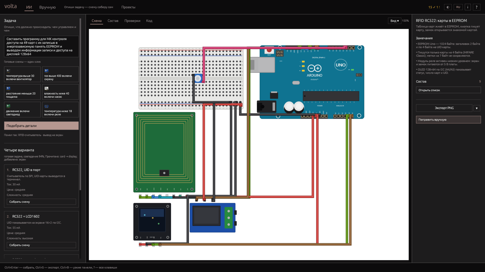

# volta

Схема из текста: макетка, Arduino Uno, скетч, проверки и экспорт.

Опишите задачу словами — `volta` подберёт детали, соберёт схему в духе
Tinkercad, напишет скетч, проверит электрику и сохранит `svg`, `png`, `ino`
и отчёт. Разбор работает офлайн, без LLM и без сети: всё решение принимается
по ключевым словам, готовым урокам и шаблонам.



## Что умеет

- **Автосборка.** Двигатели и драйвер L298N, шаговик, серво, светодиод,
  реле, пьезо, RFID RC522, радио 433 МГц и NRF24L01, Bluetooth, GSM,
  Ethernet, датчики температуры, влажности, давления, газа, света,
  расстояния и другие. По задаче предлагает несколько вариантов с током,
  ценой и сложностью; рекомендуемый вариант отмечен.
- **Семантика и ресурсы.** Задача разбирается по ролям (что измеряем, что
  управляем, условие, расписание, число нажатий), падежам и опечаткам. Перед
  сборкой проверяются свободные пины, I2C-адреса и бюджет тока; решение объясняется
  под вариантами, а неоднозначность предлагается уточнить одним кликом.
- **Явные детали в задаче.** Если текст говорит «на любой тип дисплея»,
  «на OLED» или «на два экрана», автосборка добавляет экран(ы) даже тогда,
  когда остальная формулировка совпала с готовой задачей курса: предлагает
  тип дисплея, ставит платы на шину I2C и пишет скетч с выводом времени.
- **Готовые уроки.** 51 урок по темам ATmega328: формулировка темы узнаётся
  сразу и собирается как схема со скетчом, а не как картинка. В состав включены
  660 готовых формулировок задач: текст один в один сразу открывает готовое
  решение, несовпадающий разбирается по ключевым словам.
- **Редактор.** Несколько деталей выделяются Shift+click или рамкой,
  `Ctrl+A` выделяет всё, `Ctrl+C/V/X/D` — копировать, вставить, вырезать,
  дублировать. Стрелки сдвигают на шаг сетки, кнопки выравнивания работают
  с группой. Инспектор правит обозначение, значение, поворот, класс и имя
  сети. Undo/redo — команды, а не копии всей схемы: выделение сохраняется,
  отмена перехода «Поправить вручную» тоже возможна.
- **Сети.** Имена `GND`, `+5V`, `N$1` и свои имена; экспорт `.net` для KiCad
  из меню экспорта. Наведение подсвечивает всю цепь.
- **Экспорт.** SVG, PNG и PDF без внешних утилит: PNG и PDF рисуются из тех же
  примитивов, что и окно, на чистой машине не нужен `rsvg-convert`.
- **Проверки.** Работают и без Arduino: неподключенные выводы, повторные
  обозначения, короткое питание-земля, Levels 3.3/5 В и наложенные корпуса. Ключ и кнопка привязаны к земле, PWM только на пинах
  таймеров, 3.3 В для RC522, связаны шины питания, `loop()` без `delay()`,
  все пины из скетча есть в схеме.
- **Провода.** Десять цветов для сигнальных цепей (питание красное, земля
  чёрная), цвет закреплён за парой контактов. В ручном режиме цвет можно
  выбрать самому: палитра в инструменте «Провод» задаёт цвет новых кабелей,
  а в инспекторе — цвет любого провода. В режиме «Углы» каждый провод
  делает небольшую ступеньку перед пином, поэтому кабели в одном ряду
  контактов не сливаются в линию.
- **Ручной режим.** Те же детали ставятся, тянутся, поворачиваются;
  провода можно перетаскивать за изгибы. Сохранение проектов и autosave.
- **Экспорт.** SVG, PNG, скетч Arduino и `report.json`; в окне — диалог
  сохранения файла.

## Скачать

Готовые сборки лежат на странице
[релизов](https://github.com/ElMakgit/volta/releases):

- Linux/Ubuntu x86_64 — `volta-linux-x86_64.tar.gz`;
- Windows 10/11 x86_64 — `volta-windows-x86_64.zip`.

В Linux-архиве лежат бинарник, README, лицензия, ярлык и иконка. В
Windows-архиве — `volta.exe`, README и лицензия. Рядом с архивами
публикуется `SHA256SUMS`. Обе сборки делает GitHub Actions и прикладывает
к релизу по тегу.

## Что нового в 0.8.3

- «Два датчика температуры», «два DHT22», газа, давления, почвы, света и
  расстояния ставят на макетку каждый экземпляр, а скетч читает каждый.
- DS18B20 делят одну линию 1-Wire, два BMP280 — общую I2C с адресами
  0x76/0x77, остальные датчики занимают свои аналоговые и цифровые входы.
- Модель DHT берётся из фразы: «датчик температуры DHT22» рисует DHT22, а
  не DHT11 по умолчанию.
- Больше четырёх одинаковых датчиков или больше двух BMP280 — честный
  отказ вместо ложной схемы.

## Что нового в 0.8.2

- «Пин 13 и светодиод» — один светодиод на пине 13, а не двенадцать:
  число больше не переходит через «и» на соседнюю деталь.
- «Два датчика температуры», влажности, газа, давления, расстояния, почвы
  и света считаются, а невозможная схема с несколькими датчиками честно
  отказывает вместо ложной сборки.
- «Освещение» — это лампа, а не фоторезистор; датчик света остаётся
  датчиком света в любом падеже и числе.
- Бюджет питания больше не выбрасывает названные детали: «три
  сервопривода» ставят три, а о внешнем блоке предупреждает проверка.
- Скетч не делит на ноль при 0 или 1 нажатии и не обрезает период до
  65535: «каждые 70000 мс» остаются 70000.
- Проект и конфиг сохраняются атомарно, а чужой проект с тем же именем
  больше не перезаписывается молча.
- `220 Ω` и `220 Ом` — одна строка в списке деталей.

## Что нового в 0.8.1

- «Две лампочки», «две лампы» и «пара лампочек» ставят две детали: таблица
  счёта теперь знает те же бытовые слова, что и распознавание света.
- «Две лампы накаливания» — две лампы, каждая со своим ключом; счёт ламп
  отделён от светодиодов и проверяется в требованиях.
- Синонимы других выходов («два динамика», «два спикера», «две машинки»,
  «две клавиши») тоже доходят до схемы.
- Добавлен общий регрессионный тест на число всех счётных выходов.

## Что нового в 0.8.0

- Симуляция поведения охватывает не только шаговик: мигание и вкл/выкл
  светодиода, лампу, проход сервопривода и пьезо-сигнал.
- Проверка «Логика 3.3 В» предупреждает, когда сигналы 3.3-вольтового
  модуля идут прямо в 5-вольтовые пины Uno, и подсвечивает эти пины.
- CI запускает тесты (включая медленные книжные храповики) и clippy;
  релиз не собирается, пока они не прошли. Предупреждений компилятора нет.
- `volta feedback` показывает сохранённые кнопкой «Это не то» случаи,
  `--json` отдаёт их машинно, `--corpus` печатает фразы для
  `src/testdata/phrases.txt`.
- Корпус перефразировок проверяет синонимы, а полы книжных храповиков
  вынесены в `src/testdata/book_baseline.txt`.
- Trace в русском окне полностью русский; у готового урока есть объяснение
  покрытия слотов, а заголовок называет урок.

## Что нового в 0.7.0

- Разбор строит типизированную задачу: выходы, входы, датчики, экраны, ссылки
  и счётчики — отдельные слоты с доказательствами. Победитель определяется не
  числом ключей и не порядком таблицы.
- Шаблон выбирается по слотам, которые он закрывает, и штрафуется за деталь,
  которой нет в фразе. «Драйвер двигателей и мотор» — L298N; «светодиод» — без
  лишней кнопки.
- Альтернативы — только названные прочтения. На «две кнопки и дисплей»
  собирается счётчик нажатий на экране, а не мотор с серво.
- Проценты под планом — покрытие слотов с перечнем открытого, а не доля
  совпавших слов.
- «Датчик звука к пину D5» переводит сигнал урока на D5.

## Что нового в 0.6.0

- Собирается то, что названо: матрица — `MAX7219`, семисегментный индикатор —
  `7SEG-4`, термистор — делитель NTC (а не DS18B20), часы — DS3231 вместе с
  индикатором. Урок со своим экраном больше не получает второй OLED, а скетч
  не показывает экран, которого нет на схеме.
- Задача с экраном, которую не может показать ни урок, ни рецепт, ни текстовая
  сцена, честно отказывает вместо кнопки со светодиодом.
- «Мигать каждые 200 мс» меняет период в скетче, «к пину 9» проверяется по
  схеме, а точный книжный lookup уступает общему разбору, если теряет
  названную деталь.
- `volta explain` показывает, почему выбран вариант; чек-лист читает тот же
  разбор, что и сборка; книжный храповик — 67 потерь против 71.

## Что нового в 0.5.0

- Проверка «Код ↔ схема» видит числовые пины (`pinMode(13, …)`), сверяет
  направление и ловит пин, занятый двумя деталями; Bluetooth, GSM и Ethernet
  переписаны на const-имена и проходят её.
- Добавленная кнопка действительно работает: читается с антидребезгом и
  переключает выход. RFID объявляет пин замка только у варианта с реле.
- Экраны не дублируются и не теряются: «часы на LCD1602» — один экран с
  часами, два названных экрана дают две платы и вывод на оба, «1602» — это LCD.
- Часы и текст живут рядом с выходом: «часы и пьезо» — будильник на DS3231,
  «текст и светодиод» — сообщение и мигание.
- «Драйвер двигателей и мотор» выбирает L298N, шаговик не считается мотором
  постоянного тока, у каждого добавленного реле есть нагрузка.
- Бытовые слова: «ночник» — фоторезистор и ровный светодиод, «диммер на
  симисторе» — лампа 220 В, «метеостанция» и «умный дом» находят урок.

## Что нового в 0.4.0

- Явно названные детали больше не теряются: «RFID и светодиод», «датчик газа
  и реле и мотор», «датчик движения, сервопривод и светодиод» собираются
  целиком, а код для добавленных деталей берёт тот же пин, что на схеме.
- Сервопривод, мотор, RGB, реле, пьезо и кнопка узнаются по словам и моделям
  (sg90, mg995, «вентилятор», «насос»); датчик с названным выходом даёт
  композицию с порогом.
- Названная плата важнее светодиода: RFID, радио, Bluetooth, GSM, Ethernet и
  шаговик не подменяются миганием.
- Ручной выбор языка запоминается в конфиге, подтверждённый выход больше не
  переспрашивает, PNG не срезает правую и нижнюю кромки, а окно «Об авторе»
  показывает версию.

## Что нового в 0.3.1

- «Текст приветствия на двух экранах» собирается как текстовая сцена: один
  или несколько LCD1602, LCD2004 или OLED на шине I2C, у каждого свой адрес.
- Похожесть слов больше не путает «приветствие» с «присутствием» и не
  подставляет датчик движения к задаче про текст.
- OLED больше не считается светодиодом, а число экранов читается словами:
  «два», «три», «четыре».

## Что нового в 0.3.0

- Автосборка понимает перепечатанные задачи, числа и длительности словами,
  падежи внутри ключевых фраз, сцену доступа и бытовые слова.
- Сцена доступа собирается из текста: число карт, честный лимит EEPROM,
  экран OLED/LCD1602/LCD2004 и сирена для чужой карты.
- Насос, названный с периодом, получает расписание в скетче.

Полная история изменений — в [CHANGELOG.md](CHANGELOG.md).

## Установка и сборка

```sh
bin/build        # релизная сборка
bin/test         # тесты
bin/install      # ~/.local/bin/volta, ярлык и иконка
bin/package      # архивы релиза для Linux и Windows
```

`PREFIX=/usr sudo -E bin/install` ставит в систему. Для пакета `pacman`
есть `pkgbuild/PKGBUILD`. Пик потребления памяти — около 90 МБ.

### Windows

`bin/build-windows.sh` собирает `volta.exe` из Linux кросс-компилятором
LLVM-MinGW и кладёт архив в `target/windows/volta-windows-x86_64.zip`.
На Windows с MSVC — `bin/build-windows.ps1`. Подробности, пути
`%LOCALAPPDATA%`, SmartScreen и экспорт PNG без `rsvg-convert` —
в [docs/windows.md](docs/windows.md).

PNG и PDF рисуются внутри программы, внешние утилиты не нужны.

## Запуск

```sh
volta                     # окно
volta plan  "Драйвер L298N для двух двигателей"
volta render "Считыватель RFID RC522" --out ~/Pictures/volta
volta list                # что умеет
```

Ключи `render`: `--choice N`, `--out DIR`, `--lang ru|en`, `--labels`,
`--wires arc|straight|ortho`, `--json`. Без `--choice` берётся вариант,
который план рекомендует, — тот же, что выбран в окне.

В окне: опишите задачу, нажмите «Подобрать детали» (`Ctrl+Enter`), выберите
вариант и нажмите «Собрать схему». Вкладки «Проверки» и «Код» показывают
электрику и скетч; «Поправить вручную» переносит схему в ручной режим.

## Лицензия

[MIT](LICENSE): можно использовать, менять и распространять, в том числе
в коммерческих проектах. Автор и пользователи не дают никаких гарантий;
ответственность за применение лежит на пользователе.
